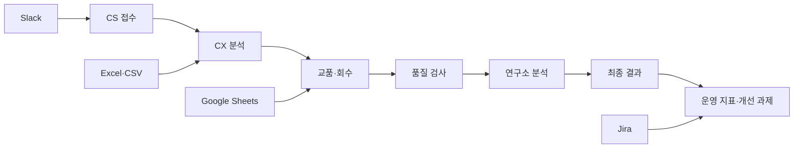

# Service Monitor Renewal

> CS 접수부터 CX 분석, 교품·회수, 품질 검사, 연구소 분석, 최종 결과까지 분산된 서비스 운영 데이터를 하나의 흐름으로 연결한 통합 관리 시스템입니다.

## 프로젝트 소개

서비스 운영 과정에서는 하나의 이슈가 여러 부서를 거치지만, 각 단계의 정보가 Excel, Slack, Google Sheets 및 개별 관리 화면에 분산되어 있었습니다. 이로 인해 현재 처리 단계와 담당 부서, 지연 원인, 과거 분석 결과를 한 번에 파악하기 어려웠습니다.

Service Monitor Renewal은 공통 업무번호와 제품·시리얼·LOT 정보를 중심으로 데이터를 연결하여 다음 질문에 빠르게 답할 수 있도록 개발했습니다.

- 현재 이슈는 어느 단계에 있으며 누가 처리하고 있는가?
- 동일 제품이나 증상에서 문제가 반복되고 있는가?
- 특정 단계의 처리 지연이 전체 SLA에 어떤 영향을 주는가?
- 교품·회수부터 품질·연구소 분석 결과까지 어떻게 이어지는가?
- 사용자의 역할과 소속에 따라 어떤 데이터와 작업을 허용해야 하는가?

## 업무 흐름



각 단계는 독립된 화면을 사용하지만, 공통 식별자와 관계형 데이터 모델을 통해 전체 처리 이력과 분석 결과를 추적합니다.

## 핵심 기능

### 1. 운영 데이터 통합

- 제품, 시리얼 번호, LOT, Transfer No. 기반 이슈 추적
- CS·CX·교품·회수·품질·연구소·최종 결과 데이터 연결
- 기기 교체 이력과 이전·현재 시리얼의 계보 조회
- 상태 변경, 처리 결과, 메모, 파일 및 작업 이력 관리

### 2. 데이터 분석 및 대시보드

- 기간·제품·주차별 접수량과 처리 현황 집계
- 처리시간의 평균, 중앙값, P75, 최댓값 분석
- SLA 준수율, 서버 가동률 및 다운타임 관리
- 손실 사유, 품질 결과, LOT 및 Jira 진행 현황 시각화
- 화면에 적용한 검색·필터 조건을 Excel 다운로드에도 동일하게 반영

### 3. 데이터 수집 자동화

- Slack 메시지의 비정형 텍스트를 운영 데이터로 정규화
- Excel·CSV 업로드 시 필수값, 날짜, 코드 및 중복 데이터 검증
- Google Sheets의 회수 일자를 주기적으로 동기화
- Jira REST API 연동을 통한 개선 과제 상태 확인

### 4. 역할·조직 기반 접근 제어

- `admin`, `user`, `viewer` 역할과 소속 팀 관리
- 대시보드·CX·교품·품질·연구소·결과 메뉴별 권한 분리
- 조회, 다운로드, 등록, 수정, 업로드, 삭제, 승인·반려 권한 세분화
- 화면 노출 여부와 별개로 모든 요청을 서버 Middleware에서 재검증
- 비밀번호 해시, 세션 만료 및 최초 로그인 비밀번호 변경 적용

## 주요 설계 결정

### 요청 처리와 외부 동기화 분리

Google Sheets I/O가 웹 요청을 지연시키지 않도록 별도의 Background Thread에서 동기화를 수행합니다. `Lock`으로 동시 실행을 제한하고 애플리케이션 종료 시 `Event`를 통해 작업을 안전하게 정리합니다.

### 데이터 무결성을 서버에서 보장

버튼 비활성화와 같은 화면 제어에 의존하지 않습니다. 서버가 사용자 권한, 현재 상태, 입력값 및 대상 데이터를 다시 확인하여 URL 직접 호출, 중복 처리, 잘못된 상태 변경을 차단합니다.

### 조회와 다운로드 결과의 일관성 유지

공통 필터 유틸리티를 사용하여 화면에서 확인한 검색 결과와 Excel 다운로드 결과가 달라지지 않도록 구성했습니다. 빈 값과 복합 조건을 포함한 필터 동작도 테스트합니다.

### 운영 지표를 의사결정 정보로 전환

단순 건수와 평균만 제공하지 않고 중앙값, P75, 최댓값, SLA 준수율을 함께 계산합니다. 일부 장기 지연 건이 평균에 미치는 영향을 구분하고 실제 병목 구간을 확인하기 위한 설계입니다.

## AI 활용 개발

이 프로젝트는 ChatGPT Codex 등 생성형 AI를 개발 파트너로 활용해 구현했습니다. AI는 다음 작업의 탐색과 반복 속도를 높이는 데 사용했습니다.

- 현업 요구사항을 데이터 모델, API, 화면 및 예외 조건으로 분해
- 구현 대안과 영향 범위 비교
- 반복 코드 작성, 리팩터링 및 오류 원인 분석
- 테스트 시나리오와 경계 조건 발굴
- 기술 문서와 운영 흐름 정리

AI가 생성한 결과를 그대로 채택하지 않고 실제 업무 규칙과 기존 데이터 흐름을 기준으로 검증했습니다. 특히 권한 우회, 필수값 누락, 날짜·코드 정규화, 중복 데이터, 상태 전환 및 외부 연동 실패를 별도의 예외 시나리오로 확인했습니다. 최종 구현은 보안성, 데이터 무결성, 운영 안정성 및 유지보수성을 기준으로 직접 판단했습니다.

## 기술 스택

| 영역 | 기술 |
|---|---|
| Backend | Python 3.12, FastAPI, SQLAlchemy |
| Frontend | Jinja2, JavaScript, HTML, CSS |
| Data | Pandas, OpenPyXL, SQLite |
| Integration | Google Sheets API, Jira REST API, Slack text parsing |
| Security | Session Middleware, Argon2, server-side authorization |
| Test | pytest |

## 프로젝트 구조

```text
app/
├─ main.py              # 애플리케이션 초기화와 라우터 구성
├─ database.py          # SQLAlchemy 연결 및 세션 관리
├─ middleware.py        # 세션·권한 검증 Middleware
├─ models/              # 업무 영역별 관계형 데이터 모델
├─ routers/             # 화면·API·업로드·다운로드 엔드포인트
├─ services/            # 권한, 제품, LOT, 분류 등 도메인 로직
├─ utils/               # 날짜, 필터, 파일 및 외부 연동 유틸리티
├─ templates/           # Jinja2 화면 템플릿
└─ static/              # JavaScript와 CSS
tests/                  # 주요 업무 규칙과 회귀 테스트
```

## 로컬 실행

### 1. 저장소와 가상환경 준비

```bash
git clone <repository-url>
cd <repository-directory>
python -m venv .venv
```

Windows PowerShell:

```powershell
.\.venv\Scripts\Activate.ps1
```

macOS/Linux:

```bash
source .venv/bin/activate
```

### 2. 의존성 설치

```bash
pip install -r requirements.txt
```

### 3. 환경 변수 설정

`.env.example`을 `.env`로 복사한 뒤 필요한 값을 입력합니다.

```env
SESSION_SECRET=replace-with-a-long-random-value
JIRA_DOMAIN=https://your-domain.atlassian.net
JIRA_EMAIL=you@example.com
JIRA_TOKEN=replace-with-your-jira-api-token
GOOGLE_SERVICE_ACCOUNT_FILE=service-account.json
GOOGLE_SPREADSHEET_ID=replace-with-your-spreadsheet-id
```

Jira와 Google Sheets를 사용하지 않는 로컬 환경에서는 해당 연동 기능을 제외한 핵심 화면과 데이터 흐름을 실행할 수 있습니다. 실제 인증 정보와 런타임 DB, 업로드 파일은 Git에 포함하지 않습니다.

### 4. 애플리케이션 실행

```bash
uvicorn app.main:app --reload
```

브라우저에서 `http://127.0.0.1:8000`으로 접속합니다. 로컬 SQLite 데이터베이스와 기본 테이블은 최초 실행 시 생성됩니다.

## 테스트

```bash
pytest
```

테스트는 다음과 같은 실제 운영 규칙과 회귀 위험을 다룹니다.

- 팀·메뉴·작업별 접근 권한
- Slack 메시지 파싱과 제품별 분류 규칙
- Excel 업로드·다운로드 정규화와 필터 일치
- 교품·회수 상태 및 기기 이력
- LOT·공정 REV 데이터 검증
- 서버 다운타임과 주차별 대시보드 계산
- Google Sheets 동기화

## 프로젝트를 통해 해결한 문제

- 부서별로 분산된 운영 데이터를 공통 식별자로 연결했습니다.
- 수작업으로 반복하던 데이터 정리와 조회 과정을 자동화했습니다.
- 운영자가 전체 진행 단계와 병목을 한 화면에서 판단할 수 있도록 했습니다.
- 권한과 예외 처리를 화면이 아닌 서버 로직으로 통제했습니다.
- AI를 활용해 개발 속도를 높이면서 테스트와 업무 규칙으로 결과를 검증했습니다.

## 향후 개선 계획

- PostgreSQL 기반 운영 DB 전환과 마이그레이션 체계 도입
- 비동기 작업 큐를 통한 외부 연동 및 대용량 파일 처리 분리
- 구조화된 감사 로그와 모니터링·알림 강화
- API·서비스 계층 단위 테스트 및 통합 테스트 확대
- 컨테이너 기반 실행·배포 환경 구성

---

이 저장소는 실제 운영 문제를 데이터와 시스템으로 구조화하고, 기획부터 구현·검증까지 연결한 과정을 보여주기 위한 프로젝트입니다.
